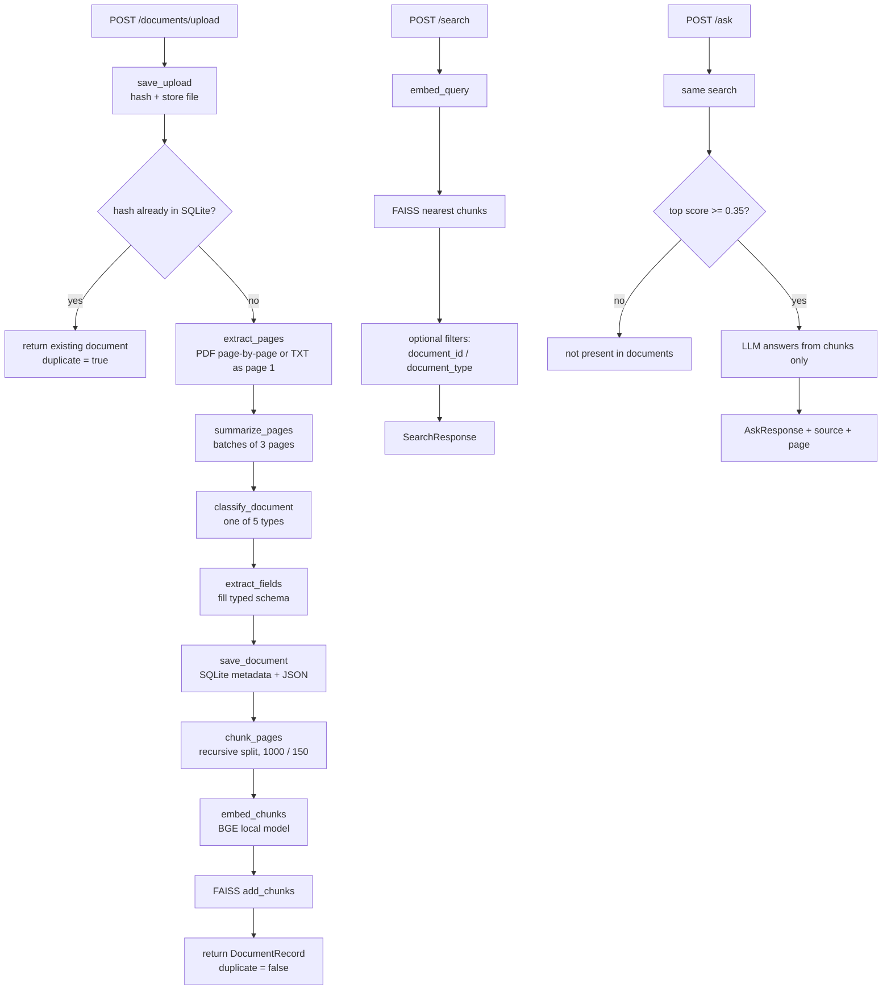
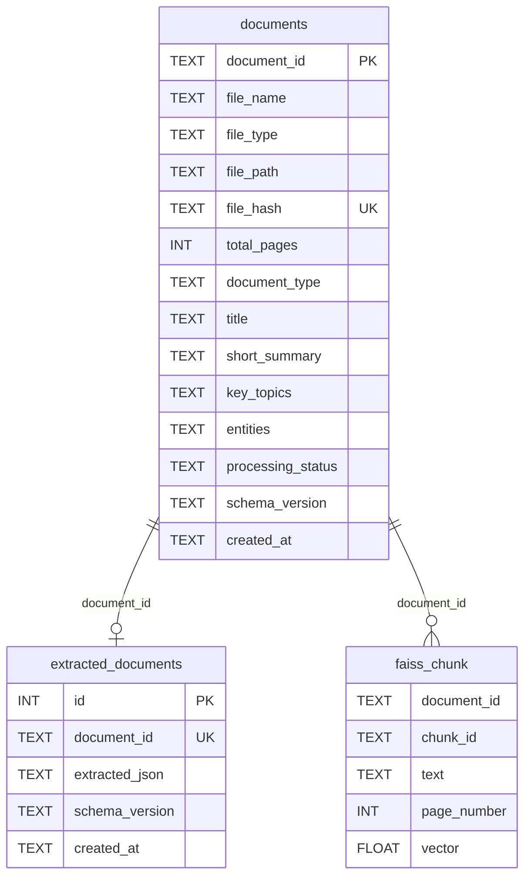
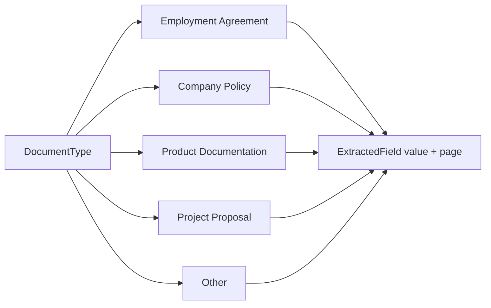
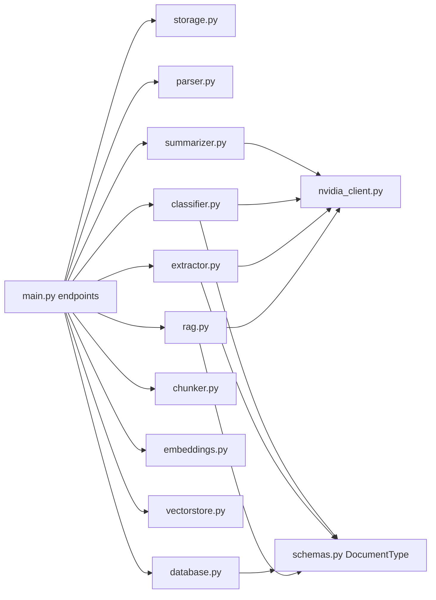

# Intelligent Document Processing and Semantic Search

Small FastAPI app that takes PDF/TXT files, extracts structured data with an LLM, and answers questions from the uploaded documents (RAG). Answers must come from the files, not from general knowledge.

## What it does

1. Upload a PDF or TXT file.
2. Extract text page by page (PyMuPDF).
3. Summarize pages in batches, classify the document type, then fill a JSON schema.
4. Store metadata and extracted JSON in SQLite.
5. Chunk the text, embed with a local model, store vectors in FAISS.
6. Search and ask questions with source, page, and supporting text.

Document types:

- Employment Agreement
- Company Policy
- Product Documentation
- Project Proposal
- Other (if it does not match the types above)

## Stack

- API: FastAPI
- LLM: NVIDIA NIM (default `nvidia/nemotron-3-ultra-550b-a55b`; OpenAI / Gemini also supported via `LLM_PROVIDER`)
- Embeddings: `BAAI/bge-base-en-v1.5` (local)
- PDF: PyMuPDF
- DB: SQLite
- Vectors: FAISS

## Run locally

```bash
python -m venv .venv
.venv\Scripts\activate
pip install -r requirements.txt
copy .env.example .env
```

Put your NVIDIA API key in `.env` as `NVIDIA_API_KEY`. Do not commit `.env`.

Then:

```bash
uvicorn app.main:app --reload
```

Swagger: http://127.0.0.1:8000/docs

## Endpoints

| Method | Path | Purpose |
|---|---|---|
| `POST` | `/documents/upload` | Save, parse, classify, extract, embed |
| `GET` | `/documents` | List uploaded documents |
| `GET` | `/documents/{id}` | Full metadata + extracted JSON |
| `POST` | `/search` | Semantic chunk search (no LLM) |
| `POST` | `/ask` | Grounded Q&A from retrieved chunks |

Errors:

- empty / unsupported files → **400** (`StorageError` / `ParseError`)
- NVIDIA / LLM failures → **502** (`LLMError`)
- unknown document id → **404**

## End-to-end flow



### Worked example: upload

Upload `Employment_Agreement.txt` containing:

```text
This Employment Agreement is made between ABC Technologies and John Doe
for the role of Software Engineer. The notice period is 60 days.
```

1. **Storage.** SHA-256 of the bytes becomes the filename, for example `Data/uploads/<hash>.txt`. Empty files and `.docx` are rejected here.
2. **Duplicate check.** If that hash is already in SQLite, the API returns the old record and does not re-parse.
3. **Parse.** TXT becomes one `Page(page_number=1, text="...")`. A 4-page PDF becomes pages 1–4.
4. **Summarize.** Pages are batched (`PAGES_PER_BATCH=3`). Each batch is summarized, then those summaries are merged into title, short summary, key topics, and entities.
5. **Classify.** The LLM must pick one of the five document types. Unknown labels fall back to `Other`.
6. **Extract.** The matching schema is filled. Missing text fields become `null`, missing lists become `[]`, extras go into `other_fields`.
7. **Save.** One row in `documents`, one row in `extracted_documents`.
8. **Chunk + embed + FAISS.** Text is split with recursive separators (paragraph → sentence → word), capped at ~1000 characters with 150 overlap. Each chunk is prefixed with filename, type, title, and summary, then embedded with `BAAI/bge-base-en-v1.5` and stored in FAISS.

After that, `/search` and `/ask` only read FAISS + SQLite. They do not re-parse the file.

Example summary JSON produced in step 4:

```json
{
  "title": "Employment Agreement - John Doe",
  "short_summary": "ABC Technologies hires John Doe. Notice period is 60 days.",
  "key_topics": ["notice period", "employment"],
  "entities": ["ABC Technologies", "John Doe"]
}
```

## Two stores, two jobs

SQLite is the source of truth for “what is this file?” FAISS is only for “which text is similar to this question?”

`/search` looks up `file_name` and `document_type` from SQLite after FAISS returns chunk ids. That is why FAISS metadata does not store the filename.



## API record schema

Every successful upload and `GET /documents/{id}` returns this shape:

```json
{
  "document_id": "a1b2c3d4-....",
  "file_metadata": {
    "file_name": "Employment_Agreement.txt",
    "file_type": "txt",
    "file_hash": "e3b0c44298fc1c...",
    "total_pages": 1,
    "uploaded_at": "2026-11-04T17:51:00+00:00"
  },
  "document_metadata": {
    "document_type": "Employment Agreement",
    "title": "Employment Agreement - John Doe",
    "short_summary": "ABC Technologies hires John Doe. Notice period is 60 days.",
    "key_topics": ["notice period"],
    "entities": ["ABC Technologies", "John Doe"]
  },
  "extracted_data": {},
  "processing_metadata": {
    "status": "completed",
    "schema_version": "1.0"
  }
}
```

`GET /documents` is a shorter list:

```json
[
  {
    "document_id": "a1b2c3d4-....",
    "file_name": "Employment_Agreement.txt",
    "document_type": "Employment Agreement",
    "uploaded_at": "2026-11-04T17:51:00+00:00",
    "status": "completed"
  }
]
```

## Extraction schemas

Every typed field is an `ExtractedField`:

```json
{ "value": "60 days", "page": 4 }
```

If the model cannot find it:

- text field → `{ "value": null, "page": null }`
- list field → `{ "value": [], "page": null }`

`missing_fields` is computed in Python from those empties. The LLM does not invent that list.



### Employment Agreement

| Field | Kind | Example |
|---|---|---|
| `company_name` | text | ABC Technologies |
| `employee_name` | text | John Doe |
| `job_title` | text | Software Engineer |
| `effective_date` | text | 1 April 2024 |
| `salary` | text | 1200000 INR per annum |
| `notice_period` | text | 60 days |
| `key_clauses` | list | Confidentiality, Termination |

```json
{
  "document_type": "Employment Agreement",
  "company_name": { "value": "ABC Technologies", "page": 1 },
  "employee_name": { "value": "John Doe", "page": 1 },
  "job_title": { "value": "Software Engineer", "page": 1 },
  "effective_date": { "value": "1 April 2024", "page": 1 },
  "salary": { "value": null, "page": null },
  "notice_period": { "value": "60 days", "page": 1 },
  "key_clauses": { "value": ["Confidentiality", "Termination"], "page": 1 },
  "other_fields": {
    "probation_period": { "value": "90 days", "page": 2 }
  },
  "missing_fields": ["salary"]
}
```

`salary` is missing because it was not in the file. `probation_period` is extra, so it lands in `other_fields`.

### Company Policy

`company_name`, `policy_name`, `policy_category`, `effective_date`, `eligibility`, `policy_rules` (list), `approval_process`

```json
{
  "document_type": "Company Policy",
  "company_name": { "value": "ABC Technologies", "page": 1 },
  "policy_name": { "value": "Work From Home Policy", "page": 1 },
  "policy_category": { "value": "HR", "page": 1 },
  "effective_date": { "value": "1 Jan 2025", "page": 1 },
  "eligibility": { "value": "Full-time employees", "page": 1 },
  "policy_rules": { "value": ["Max 3 WFH days per week", "Manager approval required"], "page": 2 },
  "approval_process": { "value": "Email manager 24 hours in advance", "page": 2 },
  "other_fields": {},
  "missing_fields": []
}
```

### Product Documentation

`product_name`, `product_version`, `description`, `features`, `technical_requirements`, `installation_steps`, `api_endpoints` (last four are lists)

```json
{
  "document_type": "Product Documentation",
  "product_name": { "value": "InvoiceBot", "page": 1 },
  "product_version": { "value": "2.1", "page": 1 },
  "description": { "value": "Automates invoice extraction", "page": 1 },
  "features": { "value": ["PDF upload", "Field extraction"], "page": 2 },
  "technical_requirements": { "value": ["Python 3.11", "8 GB RAM"], "page": 3 },
  "installation_steps": { "value": ["pip install invoicebot", "Set API key"], "page": 3 },
  "api_endpoints": { "value": ["POST /invoices", "GET /invoices/{id}"], "page": 4 },
  "other_fields": {},
  "missing_fields": []
}
```

### Project Proposal

`project_name`, `organization`, `project_objective`, `problem_statement`, `proposed_solution`, `technologies` (list), `timeline`, `budget`, `deliverables` (list)

```json
{
  "document_type": "Project Proposal",
  "project_name": { "value": "Campus RAG Assistant", "page": 1 },
  "organization": { "value": "IIIT Kottayam", "page": 1 },
  "project_objective": { "value": "Answer student queries from official PDFs", "page": 1 },
  "problem_statement": { "value": "Policy documents are hard to search", "page": 1 },
  "proposed_solution": { "value": "Upload, extract, and retrieve with FAISS", "page": 2 },
  "technologies": { "value": ["FastAPI", "FAISS", "DeepSeek"], "page": 2 },
  "timeline": { "value": "12 weeks", "page": 3 },
  "budget": { "value": "150000 INR", "page": 3 },
  "deliverables": { "value": ["API", "Test suite", "Report"], "page": 3 },
  "other_fields": {},
  "missing_fields": []
}
```

### Other

Used when the file is not one of the four types (invoice, letter, mixed notes, and so on). Only a small common set is required; the rest goes in `other_fields`.

```json
{
  "document_type": "Other",
  "title": { "value": "March Invoice", "page": 1 },
  "company_name": { "value": "ABC Technologies", "page": 1 },
  "effective_date": { "value": null, "page": null },
  "key_clauses": { "value": [], "page": null },
  "other_fields": {
    "invoice_number": { "value": "INV-21", "page": 1 },
    "amount": { "value": "50000 INR", "page": 1 }
  },
  "missing_fields": ["effective_date", "key_clauses"]
}
```

## Search and ask

**Search** embeds the query, finds nearest chunks, optionally filters, and returns the raw text. No LLM.

```json
POST /search
{
  "query": "notice period",
  "document_id": null,
  "document_type": "Employment Agreement",
  "top_k": 5
}
```

`document_type` is a free string and must match the stored label exactly, for example `"Employment Agreement"`.

```json
{
  "query": "notice period",
  "results": [
    {
      "document_id": "a1b2c3d4-....",
      "file_name": "Employment_Agreement.txt",
      "page": 1,
      "chunk_id": "a1b2c3d4-....-0",
      "score": 0.82,
      "text": "The notice period is 60 days."
    }
  ]
}
```

**Ask** runs the same search, then:

1. If there are no hits, or the best score is below `MIN_SCORE` (`0.35`), it returns *This information is not present in the uploaded documents.*
2. Otherwise it sends those chunks to the configured LLM and requires the answer to come from that context.

```json
POST /ask
{ "query": "What is the notice period?" }
```

```json
{
  "answer": "60 days.",
  "source": "Employment_Agreement.txt",
  "page": 1,
  "chunk_id": "a1b2c3d4-....-0",
  "supporting_text": "The notice period is 60 days."
}
```

If you ask “What is the CEO’s salary?” and that fact is not in any uploaded file, you get the not-found message with `source`, `page`, and `chunk_id` left null. The model is not allowed to fill gaps from general knowledge.

## How the modules line up



Config, document types, extraction schemas, SQLite, FAISS, and the five API endpoints all use the same field names and the same `{value, page}` shape.

Known design notes (not schema mismatches):

- `batch_summaries` are computed, then discarded. Only title, short summary, topics, and entities are saved.
- SQLite keeps `file_path`, but the API `FileMetadata` does not return it.
- Duplicate detection uses the DB hash. If SQLite has the file but FAISS was wiped, a re-upload is skipped and search will miss it.

## Assignment coverage

Checked against the brief (required items vs optional bonuses):

| Requirement | Status |
|---|---|
| PDF / TXT upload + text extraction | Done (`parser`, `storage`) |
| Meaningful chunking + metadata (id, name, page, chunk id, timestamp) | Done (recursive chunker + SQLite) |
| LLM structured JSON extraction with schema | Done (typed schemas per document type) |
| Missing fields + malformed LLM JSON handling | Done (`null` / `[]`, `missing_fields`, `chat_json` retry) |
| Avoid inventing facts not in the file | Done (prompts + refusal path; not perfect) |
| Embeddings + vector store + RAG answers with sources | Done (BGE + FAISS + `/ask`) |
| Five REST endpoints | Done |
| Invalid/empty files, LLM failures, no-hit queries, logging | Done |
| README, architecture diagram, sample data, Swagger, ≥5 tests | Done |
| Dedicated “compare two documents” endpoint | Not built — `/ask` can only approximate if both docs are retrieved |
| Bonus: hybrid search / reranking / background jobs / eval harness / agent | Not implemented (optional) |
| Bonus: document-level filtering | Partially done (`document_id` / `document_type` on `/search` and `/ask`) |

Sample files live under `TEST_DATA/` (TXT) and `Data/` (PDFs). Manual + automated walkthrough: [TESTING.md](TESTING.md).

External services: LLM calls go through NVIDIA NIM by default (API key required). OpenAI and Gemini are optional via `LLM_PROVIDER`. Embeddings run locally — no paid embedding API.

## Design decisions

These are the short write-ups asked for in the deliverables.

### Why I chose this embedding model

I went with `BAAI/bge-base-en-v1.5` because it is built for retrieval, not just generic sentence similarity, and it runs locally through `sentence-transformers`. For a 5–6 hour assignment that mattered: no second API bill, works offline after the first download, and the quality is good enough for English policy / agreement text.

I also normalize the vectors, so FAISS inner-product search behaves like cosine similarity. Before embedding, each chunk is prefixed with the file name, type, title, and a short summary. That is a small trick so a query like “notice period in the employment agreement” is more likely to land on the right file when several uploads share similar wording.

### How chunking works

Chunking is page-aware and recursive. Each PDF page (or the whole TXT as page 1) is split on its own so page citations stay honest.

Instead of cutting every 1000 characters blindly, the splitter tries natural breaks first: paragraphs (`\n\n`), then lines, then sentences, then words, and only then raw characters if nothing else fits. Pieces are packed up to `CHUNK_SIZE` (1000). Neighbouring chunks overlap by `CHUNK_OVERLAP` (150), except across paragraph boundaries, so a clause sitting on a boundary still shows up in both places.

Each chunk keeps `document_id`, `chunk_id`, `page_number`, and the raw text. That metadata is what `/search` and `/ask` use when they return sources.

### How retrieval relevance is determined

The query is embedded with the same BGE model. FAISS returns the nearest chunks by cosine similarity. You can optionally narrow results to one `document_id` or an exact `document_type`.

`/search` just returns those hits with scores. `/ask` is stricter: if there are no hits, or the best score is below `MIN_SCORE` (0.35), it refuses to answer. Only when retrieval looks strong enough do we send the top chunks to the LLM and ask it to answer from that context alone. A successful answer always comes back with source file, page, chunk id, and supporting text.

### How hallucinations are handled

I treated this as layered defence rather than trusting a single prompt.

On extraction, the model is told to pull only what is written, leave missing text as null / empty lists, and put unexpected facts in `other_fields`. The result has to pass a Pydantic schema; bad JSON is retried once and then fails cleanly.

On Q&A, weak retrieval never reaches the LLM. When it does, the prompt says “answer only from the context” and to admit when the answer is not there. If the model still hedges into the not-found phrase, the API returns that message with no fake source.

This reduces unsupported answers; it does not make them impossible. A fluent model can still paraphrase a weakly related chunk. That is why source text is always returned for successful answers — so a reviewer can check the claim.

### What limitations exist

Recursive character splitting is better than fixed windows, but it is still not true semantic chunking. Headings and tables are not specially detected. TXT files have no real pages, so page is always 1.

There is no keyword / hybrid search and no reranker, so exact IDs or rare terms can be missed. Uploads are processed inline, so large PDFs feel slow. Duplicate detection is hash-based: if you delete FAISS but keep SQLite, a re-upload is skipped and search can miss that file.

“Summarise the differences between two documents” is only possible in a weak sense through `/ask` if both documents are retrieved — there is no dedicated compare API. LLM quality and latency also depend on whichever provider key you configure.

## Config

Knobs live in `.env` (see `.env.example`):

| Variable | Default | Role |
|---|---|---|
| `LLM_PROVIDER` | `nvidia` | `nvidia`, `openai`, or `gemini` |
| `NVIDIA_API_KEY` | empty | Required when provider is nvidia |
| `NVIDIA_BASE_URL` | `https://integrate.api.nvidia.com/v1` | NVIDIA NIM endpoint |
| `NVIDIA_LLM_MODEL` | `nvidia/nemotron-3-ultra-550b-a55b` | Chat model on NIM |
| `OPENAI_API_KEY` / `GEMINI_API_KEY` | empty | Used when those providers are selected |
| `EMBEDDING_MODEL` | `BAAI/bge-base-en-v1.5` | Local sentence-transformers model |
| `CHUNK_SIZE` | `1000` | Characters per chunk |
| `CHUNK_OVERLAP` | `150` | Overlap between chunks |
| `TOP_K` | `5` | Search hits returned |
| `MIN_SCORE` | `0.35` | Ask refuses answers below this similarity |
| `PAGES_PER_BATCH` | `3` | Summarizer batch size |
| `MAX_PARALLEL` | `3` | Parallel summary workers |
| `SQLITE_PATH` | `Data/app.db` | Metadata database |
| `UPLOAD_DIR` | `Data/uploads` | Saved PDF/TXT files |
| `FAISS_INDEX_PATH` | `Data/faiss.index` | Vector index |
| `FAISS_META_PATH` | `Data/faiss_meta.json` | Chunk metadata next to FAISS |
| `LOG_LEVEL` | `INFO` | Logging |

## Tests

Reviewer guide (manual + automated, sample paths under `TEST_DATA/` and `Data/`): **[TESTING.md](TESTING.md)**

```powershell
pytest tests -v
```

Module-by-module commands: [tests/README.md](tests/README.md)
